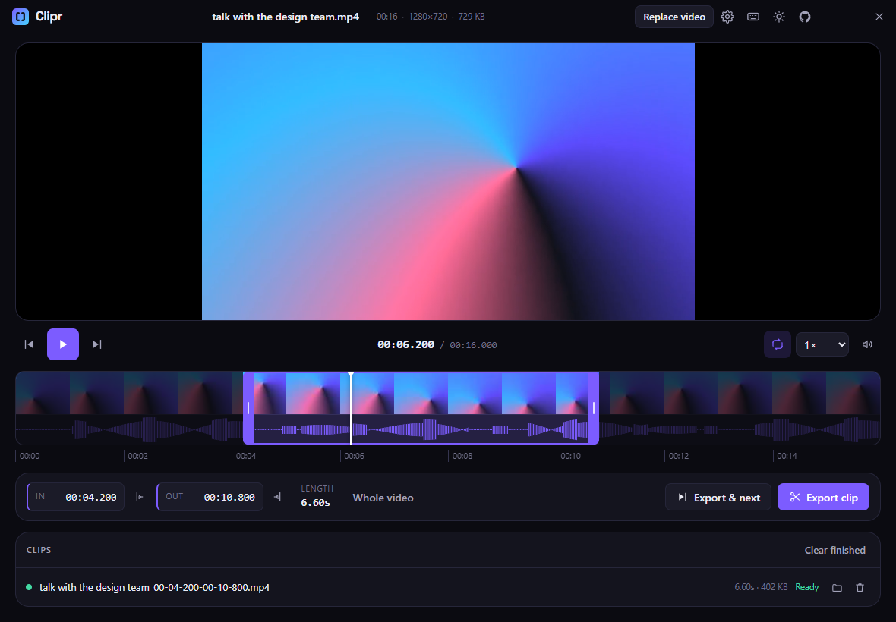

# Clipr

Drop in one or more videos, cut out what you want, add a caption if you like, and export it as
one file. No upload, no account, no watermark.

[**Open it in your browser →**](https://derthert.github.io/Clipr-App/) &nbsp;·&nbsp;
[**Download for Windows →**](https://github.com/derthert/Clipr-App/releases/latest)

[](https://github.com/derthert/Clipr-App/actions/workflows/deploy.yml)
[](https://github.com/derthert/Clipr-App/releases/latest)
[](LICENSE)



There are two ways to use it, and they look and work the same:

- **The web page.** Nothing to install. Open it, drop a video on it, done. No program, no
  extension, no account, no sign in. Any current browser, any operating system.
- **The Windows app.** A normal installer with a bundled copy of ffmpeg, so exports finish
  several times faster and huge files stop being a problem.

Either way there is no upload and no watermark. Your video is read on your own machine, so a
private recording stays private and a two gigabyte file does not have to travel anywhere first.

## Who it is for

- **People who post clips.** Pull the good thirty seconds out of a stream, a podcast or a match
  and send it straight to Discord, X or WhatsApp.
- **Teachers and presenters.** Cut the one demo you actually want to show, without opening an
  editor that wants a project file.
- **Anyone with a long recording.** Cut the dead air out of a lecture, an interview or a screen
  capture and keep only the parts that matter, as one file.
- **People who cannot upload their footage.** Client material, medical recordings, anything under
  an agreement. Nothing is sent to a server, because there is no server.

If you need transitions, effects or several stacked video tracks, you want a real editor. Clipr
does cuts, joins and captions, and does them quickly.

## How you use it

1. **Drop your videos on the page.** Or click and pick them. MP4, MOV, WebM and MKV all work. Each
   one lands on the timeline after the previous one.
2. **Shape the timeline.**
   - Press <kbd>S</kbd> to split the clip under the playhead.
   - Drag a clip's edge to trim it, or drag the whole clip to move it. Clips snap to each other,
     to the playhead and to the start, and never overlap.
   - Leave a gap between clips if you want a pause. Gaps play and export as black.
   - Click a clip and press <kbd>Delete</kbd> to remove it, or cut, copy and paste it. Paste
     drops it at the playhead and pushes later clips along.
3. **Press Export.** The whole timeline renders into one file: in the browser it goes to your
   downloads, in the Windows app it is saved next to the source video.

Click empty space on the timeline to move the playhead. Hold <kbd>Shift</kbd> and click to move it
anywhere, even over a clip, or hold <kbd>Shift</kbd> and drag to select a range you can cut, copy
or delete in one go. <kbd>Ctrl</kbd>+<kbd>Z</kbd> undoes, and the selection loops while it plays
(<kbd>L</kbd> turns that off). Press <kbd>?</kbd> in the app for the full list of keys.

### Captions

Press **Text** in the tool rail to put a caption on the text track at the playhead. Drag it on the
video to place it, pull its corners to resize it, and set the words, font, size and color in the
side panel. On the timeline it behaves like a clip: drag it to move it, drag its edges to change
how long it stays up. Captions are drawn into the exported video.

### Simple or Full

Not everyone needs every tool, so there are two editor profiles. Pick one on the start screen, in
settings, or with the switch at the bottom of the tool rail.

- **Simple** is split, trim and export. No caption tool, no clipboard buttons.
- **Full** adds captions and cut, copy and paste.

### Export settings

Everything else sits behind the gear in the corner, where you set it once and forget it: MP4, GIF
or MP3, three quality steps, a size (Original keeps the full resolution), and a mute switch. Those
choices are remembered for next time. Every export is frame exact: you get precisely the part you
kept.

## The Windows app

Grab it from the [latest release](https://github.com/derthert/Clipr-App/releases/latest):
`Clipr-Setup-x.y.z-x64.exe` to install, or `Clipr-x.y.z-x64-portable.exe` to run a single file
without installing. Windows will warn that the publisher is unknown, because the build is not
code signed; choose **More info → Run anyway**, or build it yourself with `npm run desktop:pack`.

Same screen, same shortcuts, two differences that matter:

- **It is much faster.** The desktop app ships the real ffmpeg and uses every core you have. The
  browser runs ffmpeg compiled to WebAssembly, which can use several cores too, but is still
  slower. Exporting a 30 second 1080p clip at 720p on a sixteen core machine, measured each way:

  | | Time |
  | --- | --- |
  | Windows app | 2.8 s |
  | Browser | 7.5 s |
  | Browser that can only use one core | about 38 s |

  The desktop app also makes smaller files that look better, because it can afford a slower,
  more thorough encoder setting.

- **Exports land next to the video.** No downloads folder, no save dialog. The file is written
  into the same folder as the source, numbered rather than overwritten if the name is taken, and
  each row in the clips list has a button that opens the folder.

Big files and unusual codecs are also fine there, since it is the same ffmpeg you would install
by hand.

The window has no title bar of its own. The app's own top bar is the title bar, so the settings
and the window buttons share one strip. The window opens at a fixed size and
does not resize, which is why everything on screen has a place that never moves.

## Running your own copy

Only needed if you want to host Clipr yourself or work on it. Using the app requires none of
this.

The web version is a static site, so you can open it locally or host it anywhere:

```bash
npm install
npm run dev
```

Run `npm run build` and publish the `dist` folder to put it on any host. The included GitHub
Actions workflow does exactly that for GitHub Pages on every push to `main`. `npm install` also
copies both ffmpeg.wasm engines (single and multi-threaded) into `public/ffmpeg`, so the site
works offline.

The multi-threaded engine needs the page to be cross-origin isolated. The dev and preview servers
send the required headers themselves. Hosts that cannot set headers, like GitHub Pages, are
covered by `public/coi-serviceworker.js`, which adds them and reloads the page once on the first
visit.

For the desktop app:

```bash
npm run desktop        # build once and open the app
npm run desktop:dev    # same window, with live reload while you edit
npm run desktop:pack   # installer and portable exe in release/
```

To publish a release, bump the version in `package.json`, update `.github/release-notes.md`, and
push a `v*` tag such as `v0.3.0`. The release workflow builds the Windows installer and portable
exe and publishes them on the releases page.

## Good to know

- In the browser the first export of a session takes a few extra seconds while the engine loads.
  Your browser caches it afterwards, and everything keeps working on a flaky connection because
  the work happens on your own machine.
- The very first visit to the web page reloads it once. That is the service worker switching on
  the multi-core engine. Browsers that cannot do this still work, just on a single core.
- Speed depends on your machine and the clip, never on your connection. The desktop app is the
  answer for long clips and 4K.
- Your video has to be one the player can decode. An exotic codec in an MKV is turned away rather
  than shown as a black screen.
- WebM is not offered as an export format. The VP9 encoder in the browser build crashes, and
  keeping the two versions identical is worth more than one extra format. WebM files still work
  as input.

## Contributing

Issues and pull requests are welcome, including plain "this was confusing" reports. The code is
deliberately ordinary: React, TypeScript, hand written CSS, no state library. See
[CONTRIBUTING.md](CONTRIBUTING.md) for how to run it and what the house style is.

The timeline editor and the caption layer came from [@yerkam](https://github.com/yerkam) in
[#15](https://github.com/derthert/Clipr-App/pull/15). Thanks!

Clipr cuts video with [ffmpeg](https://ffmpeg.org/): the
[WebAssembly build](https://ffmpegwasm.netlify.app/) in the browser, and a bundled native binary
in the desktop app.

## Licence

Clipr itself is MIT, see [LICENSE](LICENSE). The desktop build ships an ffmpeg binary that is
distributed under the GPL, which covers that executable rather than this source tree.
